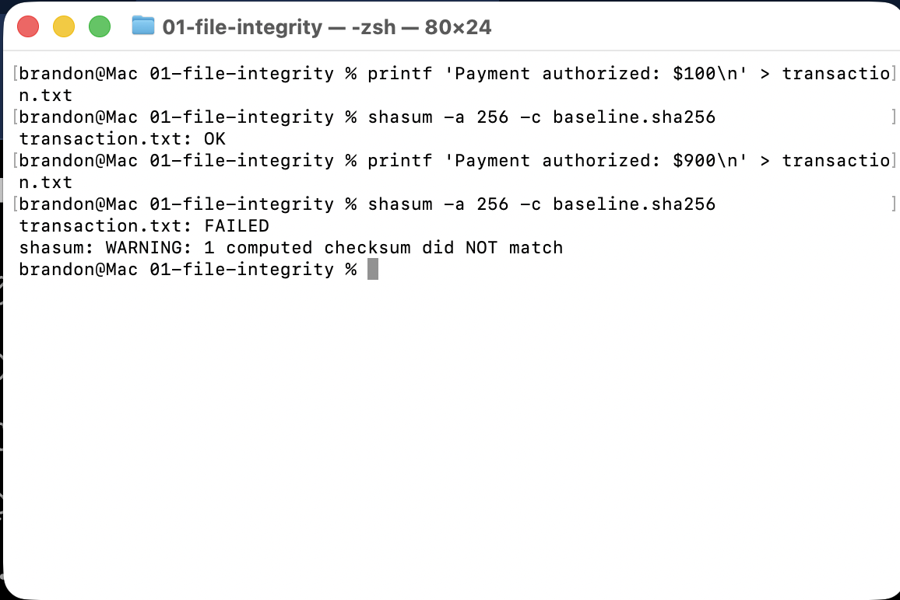

# Lab 1: File Integrity Monitoring Using SHA-256

## Objective
Demonstrate how a cybersecurity analyst can detect modifications to files using SHA-256 cryptographic hashing.

## Scenario
A fictional financial transaction record originally contained an authorized payment of $100. The amount was changed to $900 to simulate an unauthorized modification.

## Tools Used
- macOS Terminal
- Zsh shell
- SHA-256 hashing
- `shasum` command

## Results
- Original transaction: Integrity verification passed.
- Modified transaction: Integrity verification failed.
- Conclusion: SHA-256 successfully detected a change to the file.

## Skills Demonstrated
- Command-line navigation
- Cryptographic hashing
- File integrity verification
- Security investigation documentation

## Security+ Concepts
Domain 1: General Security Concepts

**CIA Triad:** Integrity

**Note:** This was a controlled educational simulation using fictional data. A hash mismatch demonstrates that a file changed, but does not identify who changed it.
## Investigation Evidence

The screenshot below demonstrates successful SHA-256 verification of the original transaction file, followed by a failed verification after the transaction amount was modified.

